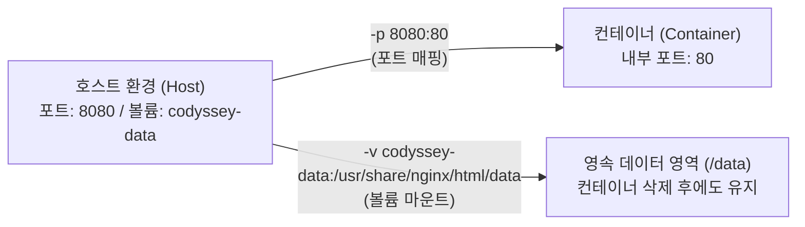

<div align="center">

# 🐳 Codyssey 1-1 — 리눅스 CLI · Docker · Git 기반 재현 가능한 개발 환경 구축
### *Reproducible Dev Workstation with Linux CLI, Docker & Git*


---

</div>

<!-- claude-drafted: 2026-11-02 -->

> **한 줄 요약:** 터미널 기본 명령어와 파일 권한(`chmod`), Docker 이미지 빌드·포트 매핑·볼륨 영속성, Git/GitHub 연동을 직접 실험·검증하고, 누가 클론하더라도 동일한 환경과 데이터를 재현할 수 있도록 설계한 프로젝트입니다.

---

## 실행 환경 요약 (Execution Environment)

| 항목 | 버전 및 환경 정보 | 확인 명령어 |
|---|---|---|
| **Host OS / Shell** | `macOS 26.6.2 (arm64)` / `zsh` | `sw_vers`, `echo $SHELL` |
| **CLI 실습 컨테이너 OS** | `Ubuntu 22.04 LTS (Linux aarch64)` / `bash` | `docker run -it ubuntu:22.04 bash` |
| **Docker Engine & Kernel** | `Docker 29.2.1 (build a5c7197)` / `Server: 29.2.1 \| Kernel: 6.12.72-linuxkit \| OS/Arch: linux/aarch64` | `docker --version`, `docker info` |
| **Git / GitHub CLI** | `git version 2.50.1` / `gh 2.99.0` (`main` 브랜치) | `git --version`, `gh auth status` |

```text
$ docker --version && docker info --format 'Server: {{.ServerVersion}} | Kernel: {{.KernelVersion}} | OS/Arch: {{.OSType}}/{{.Architecture}} | Containers: {{.Containers}} | Images: {{.Images}}'
Docker version 29.2.1, build a5c7197
Server: 29.2.1 | Kernel: 6.12.72-linuxkit | OS/Arch: linux/aarch64 | Containers: 0 | Images: 5
```

---

## 문서 지도 (라우터)

이 `README.md`는 **전체 설계 구조(항목 2)와 평가 항목 1~5 달성 요약**을 담고 있으며, 각 항목의 상세 원리 설명·실행 로그·트러블슈팅 과정 및 비전공자 눈높이 발표자료는 아래 문서에 나누어 정리했습니다.

| 문서 | 담고 있는 내용 | 대응 평가 항목 |
|---|---|---|
| **[`docs/01-verification-log.md`](docs/01-verification-log.md)** | 리눅스 CLI · 파일 권한 · Docker · 볼륨 · Git 9개 항목의 실제 실행 명령어, 터미널 출력 흔적, 인라인 캡처 | **항목 1 (기능 동작 검증)** · **항목 5 (보너스)** |
| **[`docs/02-core-principles.md`](docs/02-core-principles.md)** | 이미지 vs 컨테이너, 포트 격리와 매핑, 절대/상대 경로, `755`/`644` 권한 계산 원리 도식 및 정리 | **항목 3 (핵심 기술 원리 적용)** |
| **[`docs/03-deep-interview-qa.md`](docs/03-deep-interview-qa.md)** | 호스트 포트 충돌 진단 순서, 컨테이너 삭제 시 데이터 유실 대안 및 볼륨 백업, `가설 → 확인 → 조치` 에러 로그 및 PREP 카드 | **항목 4 (심층 인터뷰)** |
| **[`docs/Codyssey-1-1-발표자료.pptx`](docs/Codyssey-1-1-발표자료.pptx)** · **[`docs/presentation.html`](docs/presentation.html)** | 비전공자 눈높이 6대 비유(밀키트, 붕어빵 틀, 방음 방 인터폰, 외부 금고, 출입 카드키) 10장 슬라이드 & 발표 대본 | **발표 및 구술 리뷰 자료** |

---

## 항목 2. 동작 구조 설계

### 2-1. 프로젝트 디렉토리 구조와 구성 기준

변경 빈도와 역할(코드 / 인프라 설정 / 검증·원리 문서)을 분리하여, 컨테이너 이미지를 다시 빌드할 때 불필요한 레이어 캐시 무효화가 일어나지 않도록 디렉토리를 구성했습니다.

```text
codyssey-1-1/
├── README.md                          # [대문] 구조 설계(항목 2), 빠른 재현 가이드, 평가 체크리스트 라우터
├── Dockerfile                         # [인프라] 커스텀 이미지 빌드 명세 (항목 1-6)
├── docker-compose.yml                 # [보너스/재현] 포트·볼륨 설정을 코드로 고정한 선언형 실행 파일 (항목 2-2, 항목 5)
├── app/                               # [애플리케이션] 컨테이너 내부에서 서빙·실행할 대상 파일
│   └── index.html                     # 커스텀 NGINX 컨테이너가 서빙하는 정적 웹 페이지
└── docs/                              # [상세 문서] 실행 흔적·원리·심층 인터뷰·발표자료 분리 보관
    ├── 01-verification-log.md         # 항목 1 (9개 기능 동작 검증 로그) & 항목 5 (보너스)
    ├── 02-core-principles.md          # 항목 3 (핵심 기술 원리 4가지 도식 및 설명)
    ├── 03-deep-interview-qa.md        # 항목 4 (심층 인터뷰 3문항 실험 근거 및 PREP 답변 카드)
    ├── Codyssey-1-1-발표자료.pptx      # 비전공자 눈높이 설명용 PowerPoint 슬라이드 (발표자 노트 포함)
    ├── presentation.html              # 브라우저용 인터랙티브 슬라이드쇼
    └── images/                        # 항목별 인라인 터미널/브라우저 검증 스크린샷 (6종)
```

#### 실제 루트 디렉토리 트리 스냅샷 (`ls -laR` 출력)
```text
$ ls -laR Dockerfile docker-compose.yml README.md app docs
-rw-r--r--  1 <USER>  staff    514 Nov  2 15:57 Dockerfile
-rw-r--r--  1 <USER>  staff  14280 Nov 10 19:16 README.md
-rw-r--r--  1 <USER>  staff    353 Nov  2 15:58 docker-compose.yml

app:
total 8
drwxr-xr-x  3 <USER>  staff     96 Nov  2 15:57 .
drwxr-xr-x 10 <USER>  staff    320 Nov 10 19:16 ..
-rw-r--r--  1 <USER>  staff    352 Nov  2 15:57 index.html

docs:
total 248
drwxr-xr-x  8 <USER>  staff    256 Nov 10 19:16 .
drwxr-xr-x 10 <USER>  staff    320 Nov 10 19:16 ..
-rw-r--r--  1 <USER>  staff  12840 Nov 10 19:16 01-verification-log.md
-rw-r--r--  1 <USER>  staff  11920 Nov 10 19:16 02-core-principles.md
-rw-r--r--  1 <USER>  staff  14650 Nov 10 19:16 03-deep-interview-qa.md
-rw-r--r--  1 <USER>  staff  69612 Nov  2 17:45 Codyssey-1-1-발표자료.pptx
drwxr-xr-x  8 <USER>  staff    256 Nov 10 19:14 images
-rw-r--r--  1 <USER>  staff  30412 Nov  3 08:49 presentation.html

docs/images:
total 888
-rw-r--r--  1 <USER>  staff  59120 Nov  2 14:57 bind-mount-8083.png
-rw-r--r--  1 <USER>  staff 106420 Nov 10 19:14 cli-permission-log.png
-rw-r--r--  1 <USER>  staff  92180 Nov 10 19:14 docker-ops-log.png
-rw-r--r--  1 <USER>  staff  72640 Nov  2 14:58 git-github-sync.png
-rw-r--r--  1 <USER>  staff  56310 Nov  2 14:57 port-8080.png
-rw-r--r--  1 <USER>  staff  56280 Nov  2 14:57 port-8081.png
```

| 구분 기준 | 폴더/파일 | 왜 이렇게 나눴는가 (설계 근거) |
|---|---|---|
| **인프라 명세 (루트)** | [`Dockerfile`](Dockerfile), [`docker-compose.yml`](docker-compose.yml) | 저장소를 클론한 사람이 루트에서 즉시 빌드(`docker build -t codyssey-web:1.0 -f Dockerfile .`)하고 실행(`docker compose up -d`)할 수 있도록 진입점에 배치 |
| **실행 대상 (`app/`)** | [`app/index.html`](app/index.html) | 컨테이너 내부로 복사(`COPY app/ ...`)할 파일만 격리하여, 문서(`docs/`)가 바뀌어도 Docker 이미지 빌드 캐시가 깨지지 않게 분리 |
| **검증·원리 문서 (`docs/`)** | [`docs/01-verification-log.md`](docs/01-verification-log.md) 외 | 대문(`README.md`)의 가독성을 유지하면서, 실행 흔적(How)과 기술 원리(Why)·트러블슈팅 과정을 독립적으로 추적 가능하게 구성 |

### 2-2. 포트/볼륨 설정을 재현 가능하게 정리한 방식 및 호스트 OS별 주의사항

명령어 옵션을 사람 기억에 의존해 매번 수동 입력하면 포트 번호 오타나 볼륨 누락으로 인한 데이터 유실이 발생합니다. 이를 방지하기 위해 **2단계(단일 명령어 표준화 → 선언형 설정 파일 고정)**로 재현성을 확보했습니다.



1. **Docker CLI 표준 재현 명령어 (정확한 빌드·실행 옵션 명시)**:
   ```bash
   # 1. 영속 볼륨 생성 및 마운트 위치 확인
   docker volume create codyssey-data
   docker volume inspect codyssey-data

   # 2. 커스텀 이미지 빌드 (-t: 이미지명:태그, -f: Dockerfile 경로, .: 현재 폴더 빌드 컨텍스트)
   #    ※ 레이어 캐시를 무시하고 강제 재빌드할 때는 --no-cache 옵션 추가
   docker build -t codyssey-web:1.0 -f Dockerfile .

   # 3. 포트 매핑(-p 8080:80)과 볼륨 마운트(-v codyssey-data:/usr/share/nginx/html/data)로 실행
   docker run -d --name codyssey-app -p 8080:80 -v codyssey-data:/usr/share/nginx/html/data codyssey-web:1.0
   ```
2. **[`docker-compose.yml`](docker-compose.yml) 코드화 (Infrastructure as Code)**:
   - 프로젝트 이름(`name: codyssey-1-1`), 포트 매핑(`8080:80`), Named Volume(`codyssey-data`)을 [`docker-compose.yml`](docker-compose.yml)에 명시하여, 어느 컴퓨터·어느 폴더명에서든 `docker compose up -d` 한 줄로 동일한 네트워크·스토리지 구성을 재현합니다.
3. **호스트 환경별(macOS/Windows vs Linux) 재현 시 주의사항**:
   - **macOS / Windows (OrbStack · Docker Desktop 환경):** 경량 Linux VM 위에서 Docker 데몬이 구동되므로 별도의 `sudo` 없이 `docker` 명령을 실행할 수 있으며, `-p 8080:80` 매핑 시 VM 프록시(`com.docker.backend`)가 호스트의 `localhost:8080`으로 트래픽을 자동 전달합니다.
   - **Linux Native (Ubuntu 등 직접 설치 환경):** 호스트 커널의 `iptables`/`nftables`를 직접 제어하므로 현재 사용자가 `docker` 그룹에 속해 있지 않다면 `sudo` 권한이 필요하며, `-p 8080:80` 지정 시 호스트 방화벽(`ufw`)을 우회해 외부 네트워크(`0.0.0.0:8080`)로 포트가 즉시 노출되므로 로컬 전용 테스트 시에는 `-p 127.0.0.1:8080:80`으로 바인딩 범위를 제한하는 것이 안전합니다.

---

## 평가 체크리스트 달성 현황 (항목 1 ~ 5 / 세부 18개 항목)

> 모든 항목을 직접 실습·실험하여 검증을 완료했으며, 각 항목의 상세 로그와 인라인 스크린샷은 오른쪽 상대 링크에서 바로 확인할 수 있습니다.

### 항목 1. 기능 동작 검증 → 상세 흔적 및 인라인 캡처: [`docs/01-verification-log.md`](docs/01-verification-log.md)
- [x] **1-1.** 터미널에서 기본 명령어로 폴더/파일 생성·이동·삭제를 수행한 흔적이 있는가? — `mkdir`, `touch`, `cp`, `mv`, `rm`, `ls -la` 단계별 명령 라벨과 출력 로그 및 인라인 캡처([`docs/images/cli-permission-log.png`](docs/images/cli-permission-log.png)) 기록 완료 ([`docs/01-verification-log.md`](docs/01-verification-log.md) 1-1절)
- [x] **1-2.** 파일 권한 변경 결과가 확인되는가? — `chmod 644 hello.sh && ls -l hello.sh`(`-rw-r--r--`, `Permission denied`)와 `chmod 755 hello.sh && ls -l hello.sh`(`-rwxr-xr-x`, 실행 성공) 명령줄 병기 및 비교 완료 ([`docs/01-verification-log.md`](docs/01-verification-log.md) 1-2절)
- [x] **1-3.** `docker --version`이 출력되고, Docker가 동작 가능한 상태인가? — `Docker version 29.2.1` 및 `docker info` 요약(`Server: 29.2.1 | Kernel: 6.12.72-linuxkit | OS/Arch: linux/aarch64`) 확인 완료 ([`docs/01-verification-log.md`](docs/01-verification-log.md) 1-3절)
- [x] **1-4.** `docker run hello-world`가 정상 실행되는가? — `Hello from Docker!` 출력 및 실행 직후 `docker ps -a` 스냅샷(`cf285800bf18   hello-world   Exited (0)`) 첨부 완료 ([`docs/01-verification-log.md`](docs/01-verification-log.md) 1-4절)
- [x] **1-5.** 이미지/컨테이너 목록 확인 및 정리 흔적이 있는가? — 컨테이너 삭제 전 `docker rmi` 실행 시 발생하는 충돌 에러(`conflict: container cf285800bf18 is using its referenced image`)와 `docker rm` → `docker rmi` 성공 로그 및 캡처([`docs/images/docker-ops-log.png`](docs/images/docker-ops-log.png)) 기록 완료 ([`docs/01-verification-log.md`](docs/01-verification-log.md) 1-5절)
- [x] **1-6.** `Dockerfile`로 이미지 빌드가 가능한가? — `docker build -t codyssey-web:1.0 -f Dockerfile .` 명령으로 `codyssey-web:1.0`(`bbcb31fc5683`, `49.7MB`) 빌드 및 빌드 컨텍스트·캐시 영향 정리 완료 ([`docs/01-verification-log.md`](docs/01-verification-log.md) 1-6절)
- [x] **1-7.** 매핑된 포트로 접속이 가능한가? — `-p 8080:80`, `-p 8081:80` 실행 후 `curl` 응답 및 브라우저 캡처 2종([`docs/images/port-8080.png`](docs/images/port-8080.png), [`docs/images/port-8081.png`](docs/images/port-8081.png)) 인라인 첨부 완료 ([`docs/01-verification-log.md`](docs/01-verification-log.md) 1-7절)
- [x] **1-8.** Docker 볼륨 데이터가 컨테이너 삭제 후에도 유지되는가? — `docker volume ls` 및 `docker volume inspect codyssey-data`(`Mountpoint: /var/lib/docker/volumes/codyssey-data/_data`) 확인 후 컨테이너 강제 삭제 전/후 `persist.txt` 유지 증명 완료 ([`docs/01-verification-log.md`](docs/01-verification-log.md) 1-8절)
- [x] **1-9.** Git 설정 및 GitHub 연동이 확인되는가? — `git remote -v`, `gh auth status` 출력 인용 및 인라인 캡처([`docs/images/git-github-sync.png`](docs/images/git-github-sync.png)) 첨부 완료 ([`docs/01-verification-log.md`](docs/01-verification-log.md) 1-9절)
  ```text
  $ git remote -v
  origin  https://github.com/gamercross/codyssey-1-1 (fetch)
  origin  https://github.com/gamercross/codyssey-1-1 (push)
  $ gh auth status
  github.com
    ✓ Logged in to github.com account gamercross (keyring)
    - Git operations protocol: https / Token: gho_************************************
  ```

**결과:** `PASS`

---

### 항목 2. 동작 구조 설계 → 위 [항목 2. 동작 구조 설계](#항목-2-동작-구조-설계) 절
- [x] **2-1.** 프로젝트 디렉토리 구조를 어떤 기준으로 구성했는지 설명할 수 있는가? — 인프라 명세(루트), 웹 자산(`app/`), 검증·원리 문서(`docs/`)를 변경 빈도와 빌드 캐시 격리 기준으로 분리하고 `ls -laR` 스냅샷 첨부 완료
- [x] **2-2.** 포트/볼륨 설정을 어떤 방식으로 재현 가능하게 정리했는지 설명할 수 있는가? — CLI 표준 명령어 + [`docker-compose.yml`](docker-compose.yml) 선언형 고정 + 호스트 OS별(macOS/Windows VM vs Linux Native) 포트 바인딩·권한 차이 정리 완료

**결과:** `PASS`

---

### 항목 3. 핵심 기술 원리 적용 → 상세 설명: [`docs/02-core-principles.md`](docs/02-core-principles.md)
- [x] **3-1.** 이미지와 컨테이너의 차이를 "빌드/실행/변경" 관점에서 구분해 설명할 수 있는가? — 읽기 전용 불변 스냅샷(이미지) vs 임시 RW 레이어가 얹힌 격리 프로세스(컨테이너) 비교 완료. *(예시 절차: 컨테이너 내부 `docker exec` 파일 수정은 컨테이너 삭제 시 초기화되지만, 호스트 `app/index.html` 수정 후 `docker build -t codyssey-web:1.1 .`로 재빌드하면 이미지 레이어에 영구 반영됨)* ([`docs/02-core-principles.md`](docs/02-core-principles.md) 3-1절)
- [x] **3-2.** 컨테이너 내부 포트로 직접 접속할 수 없는 이유와 포트 매핑이 필요한 이유를 설명할 수 있는가? — 네트워크 네임스페이스 격리 원리와 `-p 호스트:컨테이너` 포트 포워딩 구조 정리 완료. *(보안 주의점: `-p 8080:80`은 `0.0.0.0:8080`으로 외부 네트워크 전체에 포트를 공개 노출하며, 로컬 전용 접근만 허용할 때는 `-p 127.0.0.1:8080:80`으로 바인딩 범위를 제한함)* ([`docs/02-core-principles.md`](docs/02-core-principles.md) 3-2절)
- [x] **3-3.** 절대 경로/상대 경로를 어떤 상황에서 선택하는지 설명할 수 있는가? — 컨테이너 내부 고정 경로(절대 경로) vs 저장소 이식성 확보(상대 경로) 선택 기준 정리 완료. *(권장 관례: `Dockerfile`에서는 `WORKDIR /usr/share/nginx/html`처럼 절대 경로로 작업 위치를 먼저 고정한 뒤, `COPY ./app/ ./`처럼 상대 경로로 호스트 파일을 복사하는 패턴을 권장함)* ([`docs/02-core-principles.md`](docs/02-core-principles.md) 3-3절)
- [x] **3-4.** 파일 권한 숫자 표기(예: `755`, `644`)가 어떤 규칙으로 결정되는지 설명할 수 있는가? — `r(4)+w(2)+x(1)` 주체별 합산 규칙 정리 완료. *(파일 vs 디렉토리 `x` 비트 차이: 일반 파일에서 `x(1)`는 프로그램/스크립트 실행 권한이지만, 디렉토리에서 `x(1)`는 `cd`로 폴더 내부에 진입하고 하위 파일 inode에 접근할 수 있는 탐색 권한임)* ([`docs/02-core-principles.md`](docs/02-core-principles.md) 3-4절)

**결과:** `PASS`

---

### 항목 4. 심층 인터뷰 → 상세 실험·답변 카드: [`docs/03-deep-interview-qa.md`](docs/03-deep-interview-qa.md)
- [x] **4-1.** "호스트 포트가 이미 사용 중"이라 포트 매핑이 실패한다면, 어떤 순서로 원인을 진단할지 설명할 수 있는가? — `port is already allocated` 에러 재현 후 `docker ps --filter publish=8080` → `lsof -i :8080` → 포트 해제/분리 조치 완료. *(포트 해제 유의점: 컨테이너 점유 포트는 `com.docker.backend` 데몬을 `kill -9`하지 말고 반드시 `docker stop <이름>`으로 내리며, 일반 호스트 프로세스는 `kill -15 <PID>` 정상 종료를 먼저 시도한 뒤 미응답 시에만 `kill -9 <PID>`를 사용함)* ([`docs/03-deep-interview-qa.md`](docs/03-deep-interview-qa.md) 4-1절)
- [x] **4-2.** 컨테이너 삭제 후 데이터가 사라진 경험이 있다면, 이를 방지하기 위한 대안을 설명할 수 있는가? — 볼륨 미사용 시 유실(`ephemeral-test`) vs Named Volume 보존(`codyssey-data`) 비교 실험 완료. *(볼륨 백업 권장 절차: `docker run --rm -v codyssey-data:/data:ro -v $(pwd):/backup ubuntu:22.04 tar czf /backup/backup.tar.gz -C /data .` 명령으로 볼륨 아카이브를 백업·복원함)* ([`docs/03-deep-interview-qa.md`](docs/03-deep-interview-qa.md) 4-2절)
- [x] **4-3.** 이 미션에서 가장 어려웠던 지점과 해결 과정(`가설 → 확인 → 조치`)을 근거와 함께 설명할 수 있는가? — 한글 디렉토리(`미션-수행`)에서 발생한 `project name must not be empty` 에러 원인 규명 및 `name: codyssey-1-1` 고정 조치 완료 ([`docs/03-deep-interview-qa.md`](docs/03-deep-interview-qa.md) 4-3절)
  ```text
  # [트러블 발생 당시 에러 로그]
  $ basename "$(pwd)"
  미션-수행
  $ docker compose up -d
  project name must not be empty

  # [조치 후 (docker-compose.yml 최상단에 name: codyssey-1-1 추가) 정상 실행 로그]
  $ docker compose up -d
  [+] up 2/2
   ✔ Network codyssey-1-1_default Created   0.0s
   ✔ Container codyssey-app       Started   0.1s
  ```

**결과:** `PASS`

---

### 항목 5. 보너스 문제 해결에 따른 크레딧 부여 → 상세 기록: [`docs/01-verification-log.md`](docs/01-verification-log.md)
- [x] 보너스 과제 수행 및 검증 기록 — [`docker-compose.yml`](docker-compose.yml) 작성 및 `docker compose up -d`, `ps`, `curl`, `down` 전체 생명주기 실행 로그 검증 완료 ([`docs/01-verification-log.md`](docs/01-verification-log.md) 항목 5절)

**결과:** `부여`

---

<div align="center">

# 🎉 Mission Complete

**Codyssey 1-1 — Reproducible Development Workstation**

*"원리를 이해하고 코드로 고정한 환경은 어디서든 동일하게 재현됩니다."*

</div>
