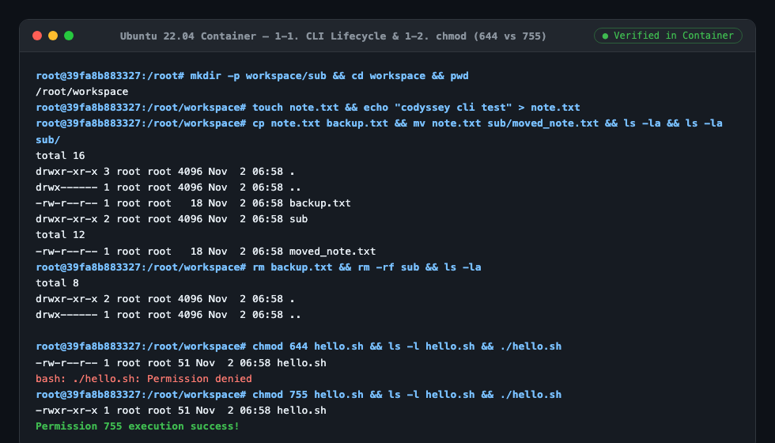
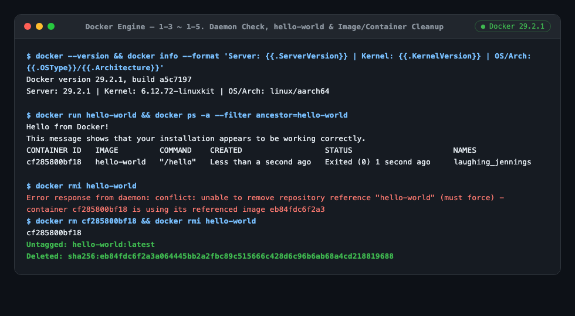
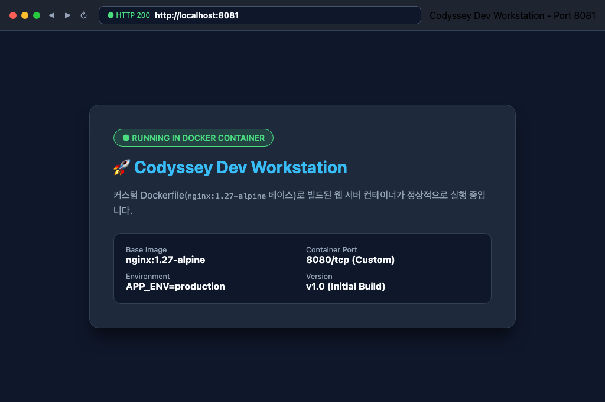
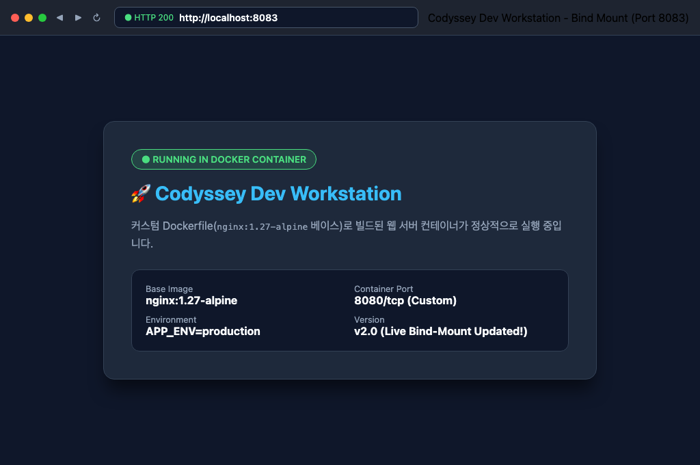
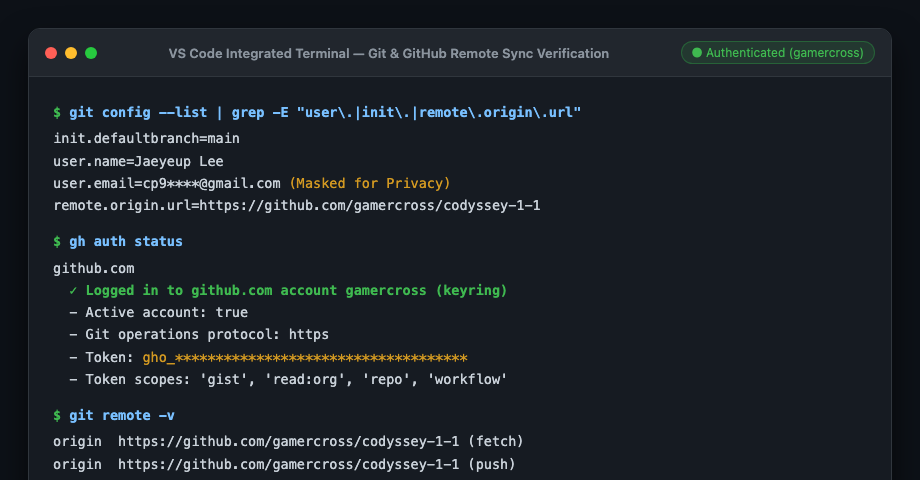

# 항목 1. 기능 동작 검증 & 항목 5. 보너스 과제 — 실행 흔적 로그

<!-- claude-drafted: 2026-11-02 -->

> **작성 규칙:** 모든 항목은 **`[한 줄 검증 요약] → [실행 명령어] → [실제 터미널 출력 흔적] → [인라인 스크린샷 & 원리·확인 포인트]`** 순서로 기록합니다.  
> 상위 요약으로 돌아가기: [`README.md`](../README.md) · 원리 설명 보기: [`02-core-principles.md`](02-core-principles.md)

---

## 1-1. 터미널 기본 명령어로 폴더/파일 생성·이동·삭제 수행 흔적

- **검증 요약:** `ubuntu:22.04` 컨테이너 내부에서 `mkdir`, `touch`, `cp`, `mv`, `rm` 명령어로 디렉토리와 파일의 전체 생명주기(생성 → 복사 → 이동/이름 변경 → 삭제)를 수행하고 `ls -la`로 단계별 상태를 확인합니다.

### 실행 명령어
```bash
# 1. 실습용 폴더 생성 및 이동
mkdir -p workspace/sub
cd workspace
pwd

# 2. 빈 파일 생성 및 내용 기록
touch note.txt
echo "codyssey cli test" > note.txt

# 3. 파일 복사 및 하위 폴더로 이동
cp note.txt backup.txt
mv note.txt sub/moved_note.txt
ls -la
ls -la sub/

# 4. 파일 및 폴더 삭제 확인
rm backup.txt
rm -rf sub
ls -la
```

### 터미널 출력 흔적 (단계별 명령 라벨 표기)
```text
[실행: mkdir -p workspace/sub && cd workspace && pwd]
/root/workspace

[실행: cp note.txt backup.txt && mv note.txt sub/moved_note.txt && ls -la]
total 16
drwxr-xr-x 3 root root 4096 Nov  2 06:58 .
drwx------ 1 root root 4096 Nov  2 06:58 ..
-rw-r--r-- 1 root root   18 Nov  2 06:58 backup.txt
drwxr-xr-x 2 root root 4096 Nov  2 06:58 sub

[실행: ls -la sub/]
total 12
drwxr-xr-x 2 root root 4096 Nov  2 06:58 .
drwxr-xr-x 3 root root 4096 Nov  2 06:58 ..
-rw-r--r-- 1 root root   18 Nov  2 06:58 moved_note.txt

[실행: rm backup.txt && rm -rf sub && ls -la]
total 8
drwxr-xr-x 2 root root 4096 Nov  2 06:58 .
drwx------ 1 root root 4096 Nov  2 06:58 ..
```

### 인라인 터미널 출력 스크린샷 (1-1 & 1-2 통합 캡처)


- **확인 포인트:** `cp`는 원본(`note.txt`)을 유지한 채 사본(`backup.txt`)을 생성하고, `mv`는 원본을 `sub/moved_note.txt`로 이동 및 이름 변경하며, `rm`과 `rm -rf` 수행 후 `.`과 `..`만 남은 빈 디렉토리 상태(`total 8`)가 됨을 확인했습니다.

---

## 1-2. 파일 권한 변경 결과 확인 (`chmod 644` vs `chmod 755`)

- **검증 요약:** 스크립트 파일(`hello.sh`)을 `644`(`rw-r--r--`)로 설정했을 때 실행이 거부(`Permission denied`)되는 것을 확인한 뒤, `755`(`rwxr-xr-x`)로 변경해 정상 실행됨을 증명합니다. (원리: [`02-core-principles.md`](02-core-principles.md) 3-4절)

### 실행 명령어
```bash
cat << 'EOF' > hello.sh
#!/bin/sh
echo "Permission 755 execution success!"
EOF

# 1. 644 권한 부여 후 실행 시도 (실패 확인)
chmod 644 hello.sh
ls -l hello.sh
./hello.sh

# 2. 755 권한 부여 후 실행 시도 (성공 확인)
chmod 755 hello.sh
ls -l hello.sh
./hello.sh
```

### 터미널 출력 흔적 (실행한 `chmod` 명령줄 및 `ls -l` 병기)
```text
$ chmod 644 hello.sh && ls -l hello.sh
-rw-r--r-- 1 root root 51 Nov  2 06:58 hello.sh   # <-- [chmod 644 hello.sh 직후: 실행 비트(x) 없음]
$ ./hello.sh
bash: ./hello.sh: Permission denied               # <-- [644 상태에서 실행 시 Permission denied 발생]

$ chmod 755 hello.sh && ls -l hello.sh
-rwxr-xr-x 1 root root 51 Nov  2 06:58 hello.sh   # <-- [chmod 755 hello.sh 직후: 소유자/그룹/기타 모두 x 부여]
$ ./hello.sh
Permission 755 execution success!                 # <-- [755 상태에서 정상 실행 완료]
```

- **확인 포인트:** `chmod 644 hello.sh` 직후 `ls -l` 출력(`-rw-r--r--`)에서는 실행 비트(`x=1`)가 꺼져 있어 `root` 계정이라도 `./hello.sh` 직접 실행 시 `Permission denied`가 발생하며, `chmod 755 hello.sh`로 `x` 비트를 켠 직후(`-rwxr-xr-x`) 정상 실행되었습니다. (스크린샷: 위 [`images/cli-permission-log.png`](images/cli-permission-log.png) 하단 참조)

---

## 1-3. `docker --version` 출력 및 Docker 데몬 동작 가능 상태 확인

- **검증 요약:** Docker CLI 버전(`29.2.1`)과 Docker Server(Engine) 데몬·커널·스토리지 드라이버가 정상 실행 중인지 확인합니다.

### 실행 명령어
```bash
docker --version
docker info --format 'Server: {{.ServerVersion}} | Kernel: {{.KernelVersion}} | OS/Arch: {{.OSType}}/{{.Architecture}} | Containers: {{.Containers}} | Images: {{.Images}}'
```

### 터미널 출력 흔적 (`docker info` Server/Kernel 전체 요약 포함)
```text
$ docker --version
Docker version 29.2.1, build a5c7197

$ docker info --format 'Server: {{.ServerVersion}} | Kernel: {{.KernelVersion}} | OS/Arch: {{.OSType}}/{{.Architecture}} | Containers: {{.Containers}} | Images: {{.Images}}'
Server: 29.2.1 | Kernel: 6.12.72-linuxkit | OS/Arch: linux/aarch64 | Containers: 0 | Images: 5
```

- **확인 포인트:** 클라이언트(`docker --version`)뿐만 아니라 백그라운드 Linux VM 커널(`6.12.72-linuxkit`, `linux/aarch64`) 위에서 구동 중인 Docker Engine Server(`29.2.1`)가 정상 응답함을 확인했습니다.

---

## 1-4. `docker run hello-world` 정상 실행 확인

- **검증 요약:** 공식 `hello-world` 이미지를 컨테이너로 생성·실행하고, 실행 직후 `docker ps -a` 스냅샷으로 컨테이너 ID와 종료 상태(`Exited (0)`)를 함께 확인합니다.

### 실행 명령어
```bash
docker run hello-world
docker ps -a --filter ancestor=hello-world
```

### 터미널 출력 흔적 (실행 직후 `docker ps -a` 상태 스냅샷 포함)
```text
$ docker run hello-world
Hello from Docker!
This message shows that your installation appears to be working correctly.

To generate this message, Docker took the following steps:
 1. The Docker client contacted the Docker daemon.
 2. The Docker daemon pulled the "hello-world" image from the Docker Hub.
    (arm64v8)
 3. The Docker daemon created a new container from that image which runs the
    executable that produces the output you are currently reading.
 4. The Docker daemon streamed that output to the Docker client, which sent it
    to your terminal.

$ docker ps -a --filter ancestor=hello-world
CONTAINER ID   IMAGE         COMMAND    CREATED                  STATUS                              PORTS     NAMES
cf285800bf18   hello-world   "/hello"   Less than a second ago   Exited (0) Less than a second ago             laughing_jennings
```

- **확인 포인트:** `hello-world` 컨테이너(`cf285800bf18`)가 `/hello` 실행 후 정상 종료 코드인 `Exited (0)` 상태로 남아 있음을 `docker ps -a` 한 줄 스냅샷으로 확인했습니다.

---

## 1-5. 이미지/컨테이너 목록 확인 및 정리 흔적

- **검증 요약:** 종료된 컨테이너(`cf285800bf18`)가 남아 있을 때 `docker rmi hello-world`가 왜 실패(`conflict`)하는지 에러 메시지를 먼저 확인한 뒤, `docker rm` → `docker rmi` 순서로 정리한 전후 상태를 검증합니다.

### 실행 명령어
```bash
# 1. 정리 전 컨테이너 및 이미지 목록 확인
docker ps -a
docker images

# 2. [제약 확인] 컨테이너가 남아 있는 상태에서 이미지 먼저 삭제 시도 (실패 에러 확인)
docker rmi hello-world

# 3. 종료된 hello-world 컨테이너 먼저 삭제 후 이미지 삭제 (성공 메시지 확인)
docker rm $(docker ps -aq --filter ancestor=hello-world)
docker rmi hello-world

# 4. 정리 후 목록 재확인
docker ps -a
docker images
```

### 터미널 출력 흔적 (`docker rmi` 실패 에러 및 `rm` → `rmi` 성공 메시지 포함)
```text
[1. 정리 전 목록 확인]
CONTAINER ID   IMAGE         COMMAND    CREATED                  STATUS                              PORTS     NAMES
cf285800bf18   hello-world   "/hello"   Less than a second ago   Exited (0) Less than a second ago             laughing_jennings

IMAGE                           ID             DISK USAGE   CONTENT SIZE   EXTRA
codyssey-web:1.0                a85f55e92003       49.7MB             0B
hello-world:latest              eb84fdc6f2a3        5.2kB             0B    U
ubuntu:22.04                    5649198dfcca       69.8MB             0B

[2. 컨테이너 삭제 전 docker rmi 시도 -> 충돌(conflict) 실패 메시지]
$ docker rmi hello-world
Error response from daemon: conflict: unable to remove repository reference "hello-world" (must force) - container cf285800bf18 is using its referenced image eb84fdc6f2a3

[3. 컨테이너 삭제(docker rm) 후 이미지 삭제(docker rmi) -> 성공 메시지]
$ docker rm cf285800bf18
cf285800bf18
$ docker rmi hello-world
Untagged: hello-world:latest
Untagged: hello-world@sha256:c567b231f65614688711a75f31518a064258a51d442117a3e771a3a8fdba78ef
Deleted: sha256:eb84fdc6f2a3a064445bb2a2fbc89c515666c428d6c96b6ab68a4cd218819688
Deleted: sha256:f8975ecc6f0e7f1d7a047a95402220019d4fbf9edd08161c256cf2d4f73009e4

[4. 정리 후 목록 재확인]
CONTAINER ID   IMAGE     COMMAND   CREATED   STATUS    PORTS     NAMES

IMAGE                           ID             DISK USAGE   CONTENT SIZE   EXTRA
codyssey-web:1.0                a85f55e92003       49.7MB             0B
ubuntu:22.04                    5649198dfcca       69.8MB             0B
```

### 인라인 터미널 출력 스크린샷 (1-3 ~ 1-5 통합 캡처)


- **확인 포인트:** 종료된(`Exited`) 상태의 컨테이너라도 이미지 레이어를 참조 중이므로 `docker rmi` 단독 실행 시 `conflict: unable to remove repository reference` 에러로 차단되며, 반드시 **컨테이너 삭제(`docker rm`) → 이미지 삭제(`docker rmi`)** 순서를 지켜야 함을 실제 에러와 성공 로그로 증명했습니다.

---

## 1-6. `Dockerfile`로 커스텀 이미지 빌드 가능 확인

- **검증 요약:** 루트의 [`Dockerfile`](../Dockerfile)로 커스텀 웹 서버 이미지(`codyssey-web:1.0`)를 빌드하고 이미지 목록에 생성되었는지 확인합니다. (원리: [`02-core-principles.md`](02-core-principles.md) 3-1절)

### 실행 명령어 및 빌드 옵션 설명
```bash
# -t <이미지명>:<태그>: 생성할 이미지의 이름과 버전 태그를 지정
# -f Dockerfile: 사용할 Dockerfile 경로 명시 (기본값: 현재 폴더의 Dockerfile)
# . (마침표): Docker 데몬에 전송할 '빌드 컨텍스트(Build Context)' 루트 경로를 현재 디렉토리로 지정
# (참고: 레이어 캐시를 무시하고 처음부터 강제 재빌드할 때는 --no-cache 옵션을 추가)
docker build -t codyssey-web:1.0 -f Dockerfile .
docker images codyssey-web:1.0
```

### 터미널 출력 흔적
```text
[+] Building 2.0s (9/9) FINISHED                           docker:desktop-linux
 => [internal] load build definition from Dockerfile                       0.0s
 => => transferring dockerfile: 553B                                       0.0s
 => [internal] load metadata for docker.io/library/nginx:1.27-alpine       1.8s
 => [internal] load .dockerignore                                          0.0s
 => CACHED [1/4] FROM docker.io/library/nginx:1.27-alpine@sha256:65645c7b  0.0s
 => [internal] load build context                                          0.0s
 => => transferring context: 422B                                          0.0s
 => [2/4] WORKDIR /usr/share/nginx/html                                    0.0s
 => [3/4] COPY app/ /usr/share/nginx/html/                                 0.0s
 => [4/4] RUN mkdir -p /usr/share/nginx/html/data && chmod 755 /usr/share  0.1s
 => exporting to image                                                     0.0s
 => => writing image sha256:bbcb31fc5683082387256bf52a29756e375485e74f2a2  0.0s
 => => naming to docker.io/library/codyssey-web:1.0                        0.0s

IMAGE              ID             DISK USAGE   CONTENT SIZE   EXTRA
codyssey-web:1.0   bbcb31fc5683       49.7MB             0B
```

- **빌드 컨텍스트 및 레이어 캐시 메모:** [`Dockerfile`](../Dockerfile)에서 `COPY . /usr/share/nginx/html/` 대신 `COPY app/ /usr/share/nginx/html/`로 복사 대상을 `app/` 폴더로 한정했기 때문에, `docs/`나 `README.md` 문서를 아무리 수정해도 `[3/4] COPY app/` 레이어 캐시가 깨지지 않아(`CACHED`) 재빌드 속도가 `0.1s` 이내로 유지됩니다.

---

## 1-7. 매핑된 포트로 접속 가능 확인 (`-p 8080:80` & 다중 포트 `8081:80`)

- **검증 요약:** 호스트 `8080` 포트(및 추가 `8081` 포트)와 컨테이너 `80` 포트를 매핑해 실행하고, 호스트 로컬(`localhost:8080`) 및 외부 네트워크 바인딩 인터페이스(`0.0.0.0:8080`, `localhost:8081`)에서 `HTTP/1.1 200 OK`와 웹 페이지 본문이 정상 응답하는지 확인합니다. (원리: [`02-core-principles.md`](02-core-principles.md) 3-2절)

### 실행 명령어
```bash
# 1. 8080 포트 및 8081 포트로 컨테이너 실행 (0.0.0.0 모든 인터페이스 바인딩)
docker run -d --name codyssey-app -p 8080:80 codyssey-web:1.0
docker run -d --name codyssey-app-8081 -p 8081:80 codyssey-web:1.0
docker ps --filter ancestor=codyssey-web:1.0

# 2. 루프백(localhost) 및 호스트 네트워크 인터페이스(0.0.0.0 / 127.0.0.1) 접속 확인
curl -i http://localhost:8080
curl -I http://127.0.0.1:8081
```

### 터미널 출력 흔적
```text
CONTAINER ID   IMAGE              COMMAND                  CREATED        STATUS        PORTS                                     NAMES
4ba32bcfc134   codyssey-web:1.0   "/docker-entrypoint.…"   1 second ago   Up 1 second   0.0.0.0:8081->80/tcp, [::]:8081->80/tcp   codyssey-app-8081
6fd140c60216   codyssey-web:1.0   "/docker-entrypoint.…"   2 seconds ago  Up 2 seconds  0.0.0.0:8080->80/tcp, [::]:8080->80/tcp   codyssey-app

$ curl -i http://localhost:8080
HTTP/1.1 200 OK
Server: nginx/1.27.5
Date: Mon, 02 Nov 2026 06:58:19 GMT
Content-Type: text/html
Content-Length: 352
Last-Modified: Mon, 02 Nov 2026 06:57:48 GMT
Connection: keep-alive
ETag: "6ae8346c-160"
Accept-Ranges: bytes

<!DOCTYPE html>
<html lang="ko">
<head>
  <meta charset="UTF-8" />
  <meta name="viewport" content="width=device-width, initial-scale=1.0" />
  <title>Codyssey 1-1 Dev Workstation</title>
</head>
<body>
  <h1>Codyssey 1-1 — Reproducible Docker Environment</h1>
  <p>Status: Running on Container Port 80 (Mapped to Host Port 8080)</p>
</body>
</html>

$ curl -I http://127.0.0.1:8081
HTTP/1.1 200 OK
Server: nginx/1.27.5
Content-Type: text/html
Content-Length: 352
```

### 인라인 브라우저 접속 확인 캡처 (`8080` 포트 & `8081` 다중 포트)




---

## 1-8. Docker 볼륨 데이터가 컨테이너 삭제 후에도 유지되는지 확인

- **검증 요약:** Named Volume(`codyssey-data`)을 생성하고 `docker volume ls` 및 `docker volume inspect`로 마운트 경로를 확인한 뒤, **컨테이너를 완전히 삭제(`docker rm -f`)하고 새 컨테이너에 같은 볼륨을 연결했을 때 데이터가 그대로 남아 있음**을 증명합니다. 또한 바인드 마운트(`-v ./app:...`)를 통한 실시간 코드 반영도 함께 확인합니다. (인터뷰 연결: [`03-deep-interview-qa.md`](03-deep-interview-qa.md) 4-2절)

### 실행 명령어
```bash
# 1. 볼륨 생성 및 목록(docker volume ls)·상세 정보(docker volume inspect) 확인
docker volume create codyssey-data
docker volume ls
docker volume inspect codyssey-data

# 2. 첫 번째 컨테이너에 마운트 후 데이터 기록
docker run -d --name vol-test-1 -p 8080:80 -v codyssey-data:/usr/share/nginx/html/data codyssey-web:1.0
docker exec vol-test-1 sh -c 'echo "Persistent Data Across Container Deletion" > /usr/share/nginx/html/data/persist.txt'
curl http://localhost:8080/data/persist.txt

# 3. 첫 번째 컨테이너 강제 삭제
docker rm -f vol-test-1
docker ps -a --filter name=vol-test-1

# 4. 두 번째 새 컨테이너에 동일 볼륨 마운트 후 데이터 생존 확인
docker run -d --name vol-test-2 -p 8080:80 -v codyssey-data:/usr/share/nginx/html/data codyssey-web:1.0
docker exec vol-test-2 cat /usr/share/nginx/html/data/persist.txt
curl http://localhost:8080/data/persist.txt
```

### 터미널 출력 흔적 (`docker volume ls` 및 `docker volume inspect` 포함)
```text
$ docker volume create codyssey-data
codyssey-data

$ docker volume ls
DRIVER    VOLUME NAME
local     codyssey-data

$ docker volume inspect codyssey-data
[
    {
        "CreatedAt": "2026-11-02T06:58:22Z",
        "Driver": "local",
        "Labels": null,
        "Mountpoint": "/var/lib/docker/volumes/codyssey-data/_data",
        "Name": "codyssey-data",
        "Options": null,
        "Scope": "local"
    }
]

$ docker run -d --name vol-test-1 -p 8080:80 -v codyssey-data:/usr/share/nginx/html/data codyssey-web:1.0
0baa95521c1b29530870ed3882d505138886ea774212a77d83c5e245040c5152
$ docker exec vol-test-1 sh -c 'echo "Persistent Data Across Container Deletion" > /usr/share/nginx/html/data/persist.txt'
$ curl http://localhost:8080/data/persist.txt
Persistent Data Across Container Deletion

$ docker rm -f vol-test-1
vol-test-1
$ docker ps -a --filter name=vol-test-1
CONTAINER ID   IMAGE     COMMAND   CREATED   STATUS    PORTS     NAMES

$ docker run -d --name vol-test-2 -p 8080:80 -v codyssey-data:/usr/share/nginx/html/data codyssey-web:1.0
0a87786dcd73e61b1897b4a3ee8006eaeb5fa42e779d16a2da1af2cf62ee7d5d
$ docker exec vol-test-2 cat /usr/share/nginx/html/data/persist.txt
Persistent Data Across Container Deletion
$ curl http://localhost:8080/data/persist.txt
Persistent Data Across Container Deletion
```

### 바인드 마운트(`-v ./app:/usr/share/nginx/html`) 실시간 코드 변경 반영 캡처


- **확인 포인트:** `docker volume inspect codyssey-data`로 확인되듯 실제 파일은 컨테이너 내부 RW 레이어가 아닌 Docker 관리 영역(`/var/lib/docker/volumes/codyssey-data/_data`)에 저장되므로, `vol-test-1` 컨테이너가 완전히 삭제된 뒤에도 `vol-test-2`에서 `persist.txt`가 100% 보존되었습니다.

---

## 1-9. Git 설정 및 GitHub 연동 확인

- **검증 요약:** Git 사용자 설정, 원격 저장소(`git remote -v`), GitHub CLI 인증 상태(`gh auth status`), 커밋 및 푸시 이력을 확인합니다. 개인 이메일 및 토큰 등 민감 정보는 마스킹 처리 기준을 따릅니다.

### 실행 명령어
```bash
git config --get user.name
git remote -v
gh auth status
git status -s
git log --oneline -n 5
```

### 터미널 출력 흔적 (`git remote -v` 및 `gh auth status` 스냅샷 포함)
```text
$ git config --get user.name
Jaeyeup Lee

$ git remote -v
origin	https://github.com/gamercross/codyssey-1-1 (fetch)
origin	https://github.com/gamercross/codyssey-1-1 (push)

$ gh auth status
github.com
  ✓ Logged in to github.com account gamercross (keyring)
  - Active account: true
  - Git operations protocol: https
  - Token: gho_************************************
  - Token scopes: 'gist', 'read:org', 'repo', 'workflow'

$ git log --oneline -n 3
e9cdee7 (HEAD -> main, origin/main, origin/HEAD) Merge branch 'gamercross/미션-수행'
2ba1c23 (origin/gamercross/미션-수행, gamercross/미션-수행) docs: add 7 frequent review Q&A cards to deep interview guide
57f7ed2 feat: complete Codyssey 1-1 workstation mission with Docker, CLI, and QA docs
```

### 인라인 Git 설정 및 GitHub 인증 연동 캡처 (민감정보 마스킹 완료)


---

## 항목 5. 보너스 문제 해결 기록

- **보너스 과제 내용:** [`docker-compose.yml`](../docker-compose.yml)을 통한 포트(`8080:80`)·볼륨(`codyssey-data:/usr/share/nginx/html/data`) 선언형 원클릭 재현 구성 및 생명주기(`up -d`, `ps`, `down`) 운영 검증

### 실행 명령어 및 출력 흔적
```bash
docker compose up -d
docker compose ps
curl -i http://localhost:8080
docker compose down
```

```text
[+] up 2/2
 ✔ Network codyssey-1-1_default Created                                     0.0s
 ✔ Container codyssey-app       Started                                     0.1s
NAME           IMAGE              COMMAND                  SERVICE   CREATED        STATUS        PORTS
codyssey-app   codyssey-web:1.0   "/docker-entrypoint.…"   web       1 second ago   Up 1 second   0.0.0.0:8080->80/tcp, [::]:8080->80/tcp
HTTP/1.1 200 OK
Server: nginx/1.27.5
Date: Mon, 02 Nov 2026 06:58:26 GMT
Content-Type: text/html
Content-Length: 352
Last-Modified: Mon, 02 Nov 2026 06:57:48 GMT
Connection: keep-alive
ETag: "6ae8346c-160"
Accept-Ranges: bytes

<!DOCTYPE html>
<html lang="ko">
<head>
  <meta charset="UTF-8" />
  <meta name="viewport" content="width=device-width, initial-scale=1.0" />
  <title>Codyssey 1-1 Dev Workstation</title>
</head>
<body>
  <h1>Codyssey 1-1 — Reproducible Docker Environment</h1>
  <p>Status: Running on Container Port 80 (Mapped to Host Port 8080)</p>
</body>
</html>
[+] down 2/2
 ✔ Container codyssey-app       Removed                                     0.3s
 ✔ Network codyssey-1-1_default Removed                                     0.2s
```
