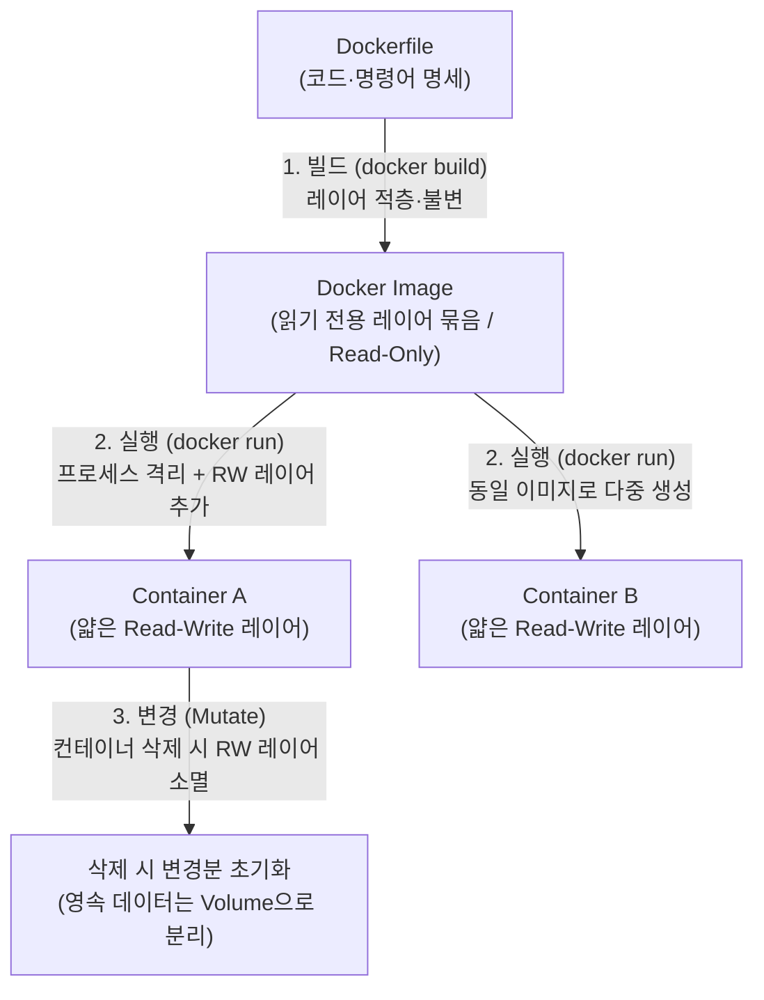
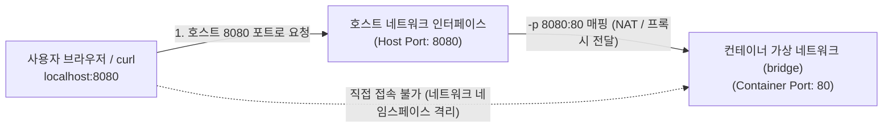
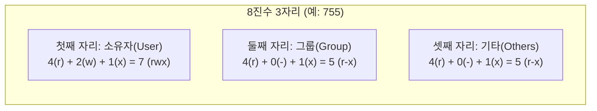

# 항목 3. 핵심 기술 원리 적용 — 공부 및 설명 노트

<!-- claude-drafted: 2026-11-02 -->

> **작성 규칙:** 모든 항목은 **`[한 줄 결론] → [원리 도식·비교표] → [내 말로 설명하기 & 실습 근거]`** 3단 구조로 정리합니다.  
> 상위 요약으로 돌아가기: [`README.md`](../README.md)

---

## 3-1. 이미지(Image)와 컨테이너(Container)의 차이 ("빌드 / 실행 / 변경" 관점)

### ① 한 줄 결론 (Point)
- **이미지(Image)**는 애플리케이션과 실행 환경을 읽기 전용(Read-Only) 레이어로 묶어 둔 **불변의 실행 템플릿(설계도)**이고, **컨테이너(Container)**는 그 이미지 위에 얇은 읽기/쓰기(Read-Write) 레이어를 얹어 실제로 메모리에 띄운 **격리된 프로세스(실행 인스턴스)**입니다.

### ② 원리 도식 및 3축 비교표 (Reason)

| 구분 관점 | Docker 이미지 (Image) | Docker 컨테이너 (Container) |
|---|---|---|
| **1. 빌드 (Build)** | `Dockerfile`의 지시어(`FROM`, `COPY`, `RUN`)를 순서대로 실행해 만든 **읽기 전용(Read-Only) 스냅샷** | 빌드 대상이 아니며, 이미 빌드된 이미지를 기반으로 즉시 생성됨 |
| **2. 실행 (Run)** | 디스크에 저장된 정적 파일 묶음이므로 그 자체로는 프로세스가 아님 (CPU·메모리 미사용) | 이미지 위에 **읽기/쓰기(Read-Write) 레이어**와 네트워크·PID 네임스페이스를 할당받아 돌아가는 **실제 프로세스** |
| **3. 변경 (Mutate)** | **불변(Immutable)** — 내용을 바꾸려면 `Dockerfile`을 고쳐 새로 빌드(새 태그/레이어 생성)해야 함 | **가변(Ephemeral)** — 실행 중 내부 파일을 수정·생성할 수 있으나, 컨테이너 삭제(`docker rm`) 시 RW 레이어도 함께 사라짐 |

### ③ 내 말로 설명하기 & 실습 근거 (Example)
- **내가 직접 설명할 핵심 문장:** *"이미지는 `Dockerfile`로 빌드한 읽기 전용 스냅샷(붕어빵 틀)이라 한 번 만들면 변하지 않고, 컨테이너는 그 이미지 위에 임시 쓰기 레이어를 얹어 실행한 프로세스(붕어빵)라서 컨테이너 안에서 파일을 고쳐도 이미지는 그대로이며 컨테이너를 지우면 그 변경분도 함께 사라집니다."*
- **실습 연결 ([`01-verification-log.md`](01-verification-log.md) 1-6 ~ 1-8절):**
  - 하나의 이미지(`codyssey-web:1.0`)로 컨테이너(`ephemeral-test`)를 띄워 내부에 `temp.txt`를 만든 뒤 `docker rm -f`로 삭제하고 새 컨테이너(`ephemeral-test-2`)를 띄웠을 때, 이미지 자체는 변하지 않았으므로 `temp.txt`가 사라진(`No such file or directory`) 반면 볼륨(`codyssey-data`)에 쓴 `persist.txt`만 남는 것으로 증명했습니다.

---

## 3-2. 컨테이너 내부 포트로 직접 접속할 수 없는 이유와 포트 매핑(`-p`)이 필요한 이유

### ① 한 줄 결론 (Point)
- 컨테이너는 호스트 OS와 분리된 **독립된 가상 네트워크 네임스페이스(사설 IP 대역)** 안에서 동작하므로 외부나 호스트 브라우저가 컨테이너 내부 포트(예: `80`)에 직접 닿을 수 없으며, 호스트의 특정 포트(예: `8080`)로 들어온 패킷을 컨테이너 내부 포트(`80`)로 전달해 주는 **포트 매핑(`-p 호스트포트:컨테이너포트`, 포트 포워딩)** 다리가 반드시 필요합니다.

### ② 원리 도식 (Reason)

| 질문 | 핵심 원리 |
|---|---|
| **왜 컨테이너 내부 포트(`80`)로 바로 못 들어가는가?** | Docker 컨테이너는 실행될 때 고유한 **Network Namespace**와 가상 브리지(`docker0`) 내부의 사설 IP를 할당받습니다. 호스트의 `localhost`와 컨테이너의 `localhost`는 서로 다른 네트워크 공간이기 때문에 격리되어 있습니다. |
| **왜 포트 매핑(`-p 8080:80`)이 필요한가?** | 호스트의 `8080`번 포트를 열어 두고(Listening), 그곳으로 들어오는 트래픽을 Docker 네트워크 프록시/NAT 규칙을 통해 격리된 컨테이너의 `80`번 포트로 포워딩해 주기 위해서입니다. 또한 이를 통해 여러 컨테이너가 내부적으로는 모두 `80`번 포트를 쓰더라도 호스트 포트만 `8080`, `8081`로 달리해 충돌 없이 동시에 띄울 수 있습니다. |

### ③ 내 말로 설명하기 & 실습 근거 (Example)
- **내가 직접 설명할 핵심 문장:** *"컨테이너는 호스트와 격리된 별도의 가상 네트워크 방(Network Namespace) 안에 있어서 컨테이너 안의 `80`번 포트는 호스트의 `80`번 포트와 연결되어 있지 않기 때문에, 호스트의 `8080`번 문으로 들어온 요청을 컨테이너 안의 `80`번 문으로 이어 주는 `-p 8080:80` 포트 포워딩이 반드시 필요합니다."*
- **실습 연결 ([`01-verification-log.md`](01-verification-log.md) 1-7절 & [`03-deep-interview-qa.md`](03-deep-interview-qa.md) 4-1절):**
  - `-p 8080:80` 옵션으로 실행한 뒤 호스트에서 `curl -i http://localhost:8080`으로 응답(`200 OK`)을 확인했고, 두 번째 컨테이너는 내부 포트 `80`을 전혀 수정하지 않은 채 호스트 매핑 포트만 `-p 8081:80`으로 바꾸어 두 컨테이너를 동시에 구동했습니다.

---

## 3-3. 절대 경로(Absolute Path)와 상대 경로(Relative Path)를 선택하는 기준

### ① 한 줄 결론 (Point)
- **절대 경로(`/...`)**는 현재 작업 위치(`pwd`)와 무관하게 **항상 동일한 시스템 위치**를 가리켜야 할 때(컨테이너 내부 마운트 지점, 시스템 설정, 크론/데몬 스크립트) 선택하고, **상대 경로(`./...`, `../...`)**는 **프로젝트 폴더 전체를 다른 컴퓨터나 디렉토리로 옮겨도 깨지지 않는 이식성(Portability)**이 필요할 때(Git 저장소 내부 파일 참조, `Dockerfile`의 `COPY`, 문서 간 링크) 선택합니다.

### ② 상황별 선택 기준표 (Reason)

| 구분 | 절대 경로 (예: `/usr/share/nginx/html`, `/var/log`) | 상대 경로 (예: `./app/index.html`, `docs/01-verification-log.md`) |
|---|---|---|
| **기준점** | 루트 디렉토리(`/`)부터 시작 | 현재 작업 디렉토리(`pwd`, `.`)부터 시작 |
| **장점** | 어느 디렉토리에서 명령어를 실행하든 대상 위치가 절대 흔들리지 않음 | 상위 폴더 경로(`/Users/이름/...`)가 바뀌거나 다른 사람이 클론해도 그대로 동작함 |
| **단점** | 호스트의 사용자명·폴더 구조가 다르면 다른 환경에서 경로 에러 발생 | 실행 위치(`cd` 한 위치)가 달라지면 파일을 찾지 못함 |
| **언제 선택하는가?** | 1. 컨테이너 내부 고정 경로 (`WORKDIR /usr/share/nginx/html`, 볼륨의 오른쪽 경로 `:/data`) 2. OS 시스템 설정 파일 (`/etc/nginx/conf.d`) | 1. `Dockerfile`에서 빌드 컨텍스트 내부 파일 복사 (`COPY ./app/ ...`) 2. `docker-compose.yml`의 바인드 마운트 왼쪽 경로 (`./app:...`) 3. 마크다운 문서 간 링크 (`docs/...`) |

### ③ 내 말로 설명하기 & 실습 근거 (Example)
- **내가 직접 설명할 핵심 문장:** *"누가 내 Git 저장소를 어느 폴더에 클론하든 똑같이 동작해야 하는 호스트 쪽 파일 참조나 문서 링크에는 **상대 경로(`app/`, `docs/...`)**를 쓰고, 컨테이너 내부처럼 OS 구조가 고정되어 있어 현재 위치(`pwd`)에 상관없이 정확한 시스템 위치를 찍어야 할 때는 **절대 경로(`/usr/share/nginx/html`)**를 선택합니다."*
- **실습 연결 ([`01-verification-log.md`](01-verification-log.md) 1-1절, 1-6절):**
  - [`Dockerfile`](../Dockerfile)의 `COPY app/ /usr/share/nginx/html/` 한 줄에서 왼쪽(`app/`)은 빌드 컨텍스트 기준 **상대 경로**로 이식성을 확보하고, 오른쪽(`/usr/share/nginx/html/`)은 컨테이너 내부 **절대 경로**로 고정 위치를 지정했습니다.

---

## 3-4. 파일 권한 숫자 표기(예: `755`, `644`)가 결정되는 규칙

### ① 한 줄 결론 (Point)
- 리눅스 파일 권한의 3자리 8진수 표기는 **소유자(Owner) · 그룹(Group) · 기타 사용자(Others)** 세 주체에 대해 각각 **읽기(`r=4`) · 쓰기(`w=2`) · 실행(`x=1`)** 값을 더한 합계(0~7)로 결정되며, 실행 파일과 디렉토리는 실행·진입(`x=1`)이 필요해 **`755`(`rwxr-xr-x`)**, 일반 문서·설정 파일은 임의 실행과 변조를 막기 위해 **`644`(`rw-r--r--`)**를 기본으로 부여합니다.

### ② 권한 계산 규칙표 (Reason)

| 권한 기호 | 의미 (파일 기준) | 의미 (디렉토리 기준) | 숫자 값 (2진수) |
|---|---|---|---|
| **`r` (Read)** | 파일 내용을 읽을 수 있음 (`cat`, `less`) | 디렉토리 안의 파일 목록을 조회할 수 있음 (`ls`) | **`4`** (`100₂`) |
| **`w` (Write)** | 파일 내용을 수정·저장할 수 있음 | 디렉토리 안에 파일을 생성·삭제·이름 변경할 수 있음 | **`2`** (`010₂`) |
| **`x` (Execute)** | 파일을 프로그램/스크립트로 실행할 수 있음 (`./script.sh`) | 디렉토리 안으로 이동(`cd`)하거나 하위 파일에 접근할 수 있음 | **`1`** (`001₂`) |
| **`-` (None)** | 권한 없음 | 권한 없음 | **`0`** (`000₂`) |

| 대표 숫자 표기 | 기호 표기 | 주체별 계산 (`소유자 / 그룹 / 기타`) | 언제 쓰는가? |
|---|---|---|---|
| **`755`** | `-rwxr-xr-x` | `7(4+2+1)` / `5(4+0+1)` / `5(4+0+1)` | **실행 스크립트(`*.sh`), 공개 디렉토리** — 소유자만 수정 가능하고 누구나 실행·진입 가능 |
| **`644`** | `-rw-r--r--` | `6(4+2+0)` / `4(4+0+0)` / `4(4+0+0)` | **일반 파일(`index.html`, 설정 파일, 문서)** — 소유자만 수정 가능하고 누구나 읽을 수 있으되 실행은 불가 |
| **`700` / `600`** | `-rwx------` / `-rw-------` | `7` 또는 `6` / `0` / `0` | **비밀키(`id_rsa`, `.env`) 및 개인 전용 스크립트** — 소유자 외에는 읽기·접근조차 전면 차단 (최소 권한 원칙) |

### ③ 내 말로 설명하기 & 실습 근거 (Example)
- **내가 직접 설명할 핵심 문장:** *"`r=4, w=2, x=1` 값을 소유자·그룹·기타 사용자 세 자리별로 합산하기 때문에, 소유자만 수정하고 모두 읽을 수 있는 일반 파일(`index.html`)은 `6(4+2) / 4 / 4 = 644`가 되고, 직접 실행해야 하는 쉘 스크립트(`hello.sh`)나 내부로 진입(`cd`)해야 하는 폴더(`/usr/share/nginx/html/data`)는 세 주체 모두에게 실행 비트(`1`)가 더해져 `7(4+2+1) / 5(4+1) / 5(4+1) = 755`가 됩니다."*
- **실습 연결 ([`01-verification-log.md`](01-verification-log.md) 1-2절):**
  - `hello.sh`에 `chmod 644`를 주었을 때 `./hello.sh` 실행이 `Permission denied`로 차단되는 것을 확인하고, `chmod 755`로 변경한 뒤 `Permission 755 execution success!`가 출력되는 결과로 증명했습니다.
