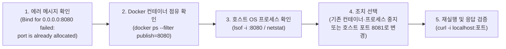

# 항목 4. 심층 인터뷰 — 트러블슈팅 실험 및 구술 답변 카드 (PREP)

<!-- claude-drafted: 2026-11-02 -->

> **작성 규칙:** 각 인터뷰 문항은 **① 직접 재현한 실험(`가설 → 확인 → 조치`)**과 **② 60초 안에 말할 수 있는 `PREP(결론 → 이유 → 사례 → 결론)` 답변 카드**로 구성합니다.  
> 상위 요약으로 돌아가기: [`README.md`](../README.md) · 실행 로그 보기: [`01-verification-log.md`](01-verification-log.md) · 발표 슬라이드 보기: [`presentation.html`](presentation.html) / [`Codyssey-1-1-발표자료.pptx`](Codyssey-1-1-발표자료.pptx)

---

## 4-1. "호스트 포트가 이미 사용 중"이라 포트 매핑이 실패할 때의 진단 순서

### ① 원인 진단 흐름도 (5단계 표준 절차)



| 순서 | 진단 단계 | 실행 명령어 | 확인하는 내용 및 포트 해제 유의점 |
|---|---|---|---|
| **1** | 에러 원문 및 충돌 포트 특정 | `docker run -p 8080:80 ...` 에러 출력 확인 | 컨테이너 내부 에러가 아니라 **호스트의 몇 번 포트(`8080`) 바인딩 실패**인지 확인 |
| **2** | 다른 Docker 컨테이너 점유 확인 | `docker ps --filter publish=8080` | 내가 이전에 띄워 두고 끄지 않은 다른 컨테이너가 `8080`을 쓰고 있는지 먼저 확인 |
| **3** | 호스트 OS 일반 프로세스 확인 | `lsof -i :8080` (또는 리눅스 `ss -tulpn \| grep :8080`) | Docker가 아니라면 호스트에서 돌아가는 로컬 서버(Node, Python, Nginx 등)의 **PID와 프로세스 이름** 특정 |
| **4** | 원인별 포트 해제 또는 분리 조치 | • Docker 컨테이너인 경우: `docker stop <이름> && docker rm <이름>`<br/>• 호스트 일반 프로세스인 경우: `kill -15 <PID>` (정상 종료 우선)<br/>• 기존 서비스 유지 시: `-p 8081:80`으로 호스트 포트 변경 | **[유의점]** `lsof`에 `com.docker.backend`가 뜬다고 해서 그 PID를 `kill -9`로 죽이면 **Docker 데몬 전체가 강제 종료**됩니다. 컨테이너 점유 포트는 반드시 `docker stop`으로 해제하고, 일반 프로세스도 데이터 손실 방지를 위해 `kill -15`(SIGTERM)를 먼저 시도한 뒤 응답이 없을 때만 `kill -9`(SIGKILL)를 사용합니다. |

### ② 일부러 실패해 본 실험 흔적
```text
# 1. 이미 codyssey-app이 8080 포트를 점유한 상태에서 두 번째 컨테이너를 동일 호스트 포트(8080)로 실행 시도
$ docker run -d --name codyssey-app-conflict -p 8080:80 codyssey-web:1.0
1850d819832c539cd4114e9f86b950d4bbdc2b1a858e1b2eccee51051ad542a6
docker: Error response from daemon: failed to set up container networking: driver failed programming external connectivity on endpoint codyssey-app-conflict: Bind for 0.0.0.0:8080 failed: port is already allocated

# 2. [진단 1단계] Docker 컨테이너 중 8080 포트를 매핑 중인 컨테이너 검색
$ docker ps --filter publish=8080 --format "table {{.ID}}\t{{.Names}}\t{{.Status}}\t{{.Ports}}"
CONTAINER ID   NAMES          STATUS        PORTS
6fd140c60216   codyssey-app   Up 1 second   0.0.0.0:8080->80/tcp, [::]:8080->80/tcp

# 3. [진단 2단계] 호스트 OS 레벨에서 8080 포트(http-alt)를 LISTEN 중인 프로세스(PID) 확인
$ lsof -i :8080 | head -n 5
COMMAND     PID    USER   FD   TYPE             DEVICE SIZE/OFF NODE NAME
com.docke 65420 <USER>  152u  IPv6 0x18dbffa2a10556e5      0t0  TCP *:http-alt (LISTEN)

# 4-A. [조치 방법 1: 기존 점유 컨테이너/프로세스를 중지해 8080 포트를 해제하는 경우]
# - Docker 컨테이너 점유 시: docker stop codyssey-app
# - 호스트 일반 프로세스 점유 시: kill -15 <PID> (정상 종료 유도, 미응답 시에만 kill -9 <PID>)

# 4-B. [조치 방법 2: 기존 codyssey-app(8080)을 유지한 채 호스트 포트만 8081로 분리하여 동시 실행]
$ docker rm -f codyssey-app-conflict
$ docker run -d --name codyssey-app-8081 -p 8081:80 codyssey-web:1.0
4ba32bcfc1347c30ee765c6d70cda7f047dba42f7dbcc47767869aa608f5c475

$ curl -I -s http://localhost:8081
HTTP/1.1 200 OK
Server: nginx/1.27.5
Content-Type: text/html
Content-Length: 352
```

### ③ 구술 답변 카드 (PREP — 60초)
> *(PREP은 출처 확인 불가, 실무에서 통용되는 후보 구조)*
- **P (결론):** 호스트 포트 충돌이 발생하면 **① 에러 로그로 포트 번호 특정 → ② `docker ps --filter publish=포트`로 기존 컨테이너 확인 → ③ `lsof -i :포트`로 호스트 프로세스(PID) 확인 → ④ `docker stop` / `kill -15 <PID>`로 해제하거나 호스트 매핑 포트만 변경**하는 4단계 순서로 진단합니다.
- **R (이유):** 하나의 호스트 IP와 포트 조합에는 동시에 하나의 소켓만 바인딩할 수 있는데, 점유 주체가 이전에 띄운 Docker 컨테이너일 수도 있고 호스트 OS에서 직접 실행 중인 로컬 서버일 수도 있어 좁혀 나가야 하기 때문입니다.
- **E (사례):** 실제로 `codyssey-app`이 `8080` 포트로 떠 있는 상태에서 `codyssey-app-conflict`를 `-p 8080:80`으로 실행해 `Bind for 0.0.0.0:8080 failed: port is already allocated` 에러를 재현했고, `docker ps --filter publish=8080`과 `lsof -i :8080`으로 `codyssey-app`(`PID 65420`)이 점유 중임을 확인한 뒤 컨테이너 내부 포트(`80`)는 그대로 두고 호스트 포트만 `-p 8081:80`으로 분리해 두 웹 서버를 동시에 띄웠습니다.
- **P (결론):** 따라서 무작정 `kill -9`로 프로세스를 죽이기보다(특히 Docker 프로세스를 강제 종료하면 전체 데몬이 멈추므로 주의), `docker ps`와 `lsof`로 점유 주체를 먼저 식별해 안전하게 해제하거나 호스트 매핑 포트를 분리해 해결합니다.

---

## 4-2. 컨테이너 삭제 후 데이터가 사라진 경험과 이를 방지하기 위한 대안

### ① 데이터 유실 원인과 영속화 대안 비교


| 방식 | 동작 원리 | 주로 쓰는 상황 | 장점 / 주의점 |
|---|---|---|---|
| **Named Volume**<br/>(`-v 볼륨명:/컨테이너경로`) | Docker가 관리하는 호스트 전용 영역(`/var/lib/docker/volumes/...`)에 데이터를 분리 저장 | **DB 데이터, 업로드 파일, 운영 환경 영속 데이터** | 호스트 디렉토리 구조에 의존하지 않아 **이식성과 재현성이 가장 높음** (`docker volume rm` 전까지 유지) |
| **Bind Mount**<br/>(`-v ./호스트경로:/컨테이너경로`) | 호스트의 특정 폴더/파일을 컨테이너 내부 경로에 직접 연결 | **로컬 개발 중 소스 코드 실시간 반영, 설정 파일 주입** | 호스트에서 수정하면 컨테이너에 즉시 반영되지만, 호스트 경로 구조와 파일 권한(`chmod`) 영향을 직접 받음 |

### ② 유실 vs 보존 비교 실험 요약 ([`01-verification-log.md`](01-verification-log.md) 1-8절 연결)
```text
# [실험 A: 볼륨 미사용 시 컨테이너 삭제 후 데이터 유실 재현]
$ docker run -d --name ephemeral-test -p 8080:80 codyssey-web:1.0
$ docker exec ephemeral-test sh -c 'echo "Temporary Data in RW Layer" > /usr/share/nginx/html/temp.txt && cat /usr/share/nginx/html/temp.txt'
Temporary Data in RW Layer
$ docker rm -f ephemeral-test
$ docker run -d --name ephemeral-test-2 -p 8080:80 codyssey-web:1.0
$ docker exec ephemeral-test-2 cat /usr/share/nginx/html/temp.txt
cat: can't open '/usr/share/nginx/html/temp.txt': No such file or directory

# [실험 B: Named Volume(codyssey-data) 적용 시 컨테이너 삭제 후에도 데이터 보존 증명]
$ docker volume create codyssey-data
$ docker run -d --name vol-test-1 -p 8080:80 -v codyssey-data:/usr/share/nginx/html/data codyssey-web:1.0
$ docker exec vol-test-1 sh -c 'echo "Persistent Data Across Container Deletion" > /usr/share/nginx/html/data/persist.txt'
$ docker rm -f vol-test-1
$ docker run -d --name vol-test-2 -p 8080:80 -v codyssey-data:/usr/share/nginx/html/data codyssey-web:1.0
$ curl -s http://localhost:8080/data/persist.txt
Persistent Data Across Container Deletion
```

### ③ Named Volume 아카이브 백업(Export) 및 복원(Import) 권장 절차
볼륨 자체를 실수로 삭제(`docker volume rm`)하거나 다른 서버로 이전해야 할 때를 대비해, 일회성 컨테이너와 `tar`를 결합한 표준 백업·복원 절차를 함께 마련했습니다.
```bash
# 1. [볼륨 백업 (Export)] codyssey-data 볼륨 내용을 호스트의 codyssey-data-backup.tar.gz로 압축 저장
docker run --rm -v codyssey-data:/data:ro -v "$(pwd):/backup" ubuntu:22.04 \
  tar czf /backup/codyssey-data-backup.tar.gz -C /data .

# 2. [볼륨 복원 (Import)] 새 볼륨(codyssey-data-restored)에 백업 압축 파일 풀기
docker volume create codyssey-data-restored
docker run --rm -v codyssey-data-restored:/data -v "$(pwd):/backup:ro" ubuntu:22.04 \
  tar xzf /backup/codyssey-data-backup.tar.gz -C /data
```

### ④ 구술 답변 카드 (PREP — 60초)
> *(PREP은 출처 확인 불가, 실무에서 통용되는 후보 구조)*
- **P (결론):** 컨테이너 삭제 시 데이터가 사라지는 문제를 막기 위해, 데이터의 생명주기를 컨테이너와 분리하는 **Docker Named Volume(운영·데이터 영속화)**과 **Bind Mount(개발 중 코드·설정 실시간 연동)**를 목적에 맞게 구분해 사용하며, 중요 볼륨은 `tar` 아카이브로 정기 백업합니다.
- **R (이유):** 컨테이너의 기본 읽기/쓰기(Read-Write) 레이어는 컨테이너 프로세스에 종속된 임시 공간이라, 컨테이너를 삭제(`docker rm`)하면 그 안에 기록된 변경분도 함께 소멸하기 때문입니다.
- **E (사례):** 실제로 볼륨 없이 `ephemeral-test` 컨테이너 내부에 `temp.txt`를 생성한 뒤 컨테이너를 삭제하고 새로 띄웠을 때는 `No such file or directory`가 발생하며 데이터가 유실되었지만, `codyssey-data` Named Volume을 `/usr/share/nginx/html/data`에 마운트한 뒤에는 `vol-test-1`을 강제 삭제(`docker rm -f`)하고 새 컨테이너 `vol-test-2`를 띄워도 `persist.txt` 데이터가 그대로 유지됨을 확인했습니다.
- **P (결론):** 결론적으로 컨테이너는 언제든 지우고 다시 띄울 수 있는 무상태(Stateless)로 두고, 유지되어야 하는 상태(State)는 반드시 볼륨으로 외부화해 관리합니다.

---

## 4-3. 이 미션에서 가장 어려웠던 지점과 해결 과정 (`가설 → 확인 → 조치`)

### ① 문제 해결 기록표 (`가설 → 확인 → 조치`)

| 단계 | 내용 | 근거 (명령어 · 로그 · 문서) |
|---|---|---|
| **문제 상황 (Symptom)** | 작업 폴더 이름이 한글(`미션-수행`)로 된 워크트리에서 보너스 과제인 `docker compose up -d`를 실행했을 때, 컨테이너가 기동되지 않고 `project name must not be empty` 에러가 발생하며 즉시 실패함 | `$ docker compose up -d`<br/>`project name must not be empty` |
| **가설 (Hypothesis)** | *"Docker Compose는 별도의 프로젝트 이름이 지정되지 않으면 현재 폴더명을 소문자 영문·숫자(`a-z0-9`)만 남기고 정규화해 기본 프로젝트 이름으로 쓰는데, 폴더명이 순수 한글(`미션-수행`)이라 정규화 후 빈 문자열(`""`)이 되어 에러가 발생했을 것이다."* | Docker Compose 프로젝트 이름 생성 규칙 (기본값 = 현재 디렉토리명에서 비영문/특수문자 제거) |
| **확인 (Verification)** | `pwd`로 현재 디렉토리명이 한글(`미션-수행`)임을 확인하고, `-p codyssey-1-1` 플래그로 프로젝트 이름을 명시해 테스트했을 때 정상 동작함을 확인함 | `$ docker compose -p codyssey-1-1 config` 정상 파싱 확인 |
| **조치 및 재발 방지 (Action)** | 사용자가 매번 `-p` 옵션을 수동으로 치지 않고 어느 이름의 폴더에 클론하더라도 100% 재현되도록 [`docker-compose.yml`](../docker-compose.yml) 최상단에 `name: codyssey-1-1`을 코드로 고정함 | [`docker-compose.yml`](../docker-compose.yml) `name: codyssey-1-1` 추가 후 [`01-verification-log.md`](01-verification-log.md) 항목 5에서 `docker compose up -d` 성공 검증 |

### ② 트러블슈팅 발생 전/후 전체 에러 로그 스냅샷
```text
# [조치 전: 한글 폴더('미션-수행')에서 name 지정 없이 실행 시 발생한 전체 에러 로그]
$ basename "$(pwd)"
미션-수행
$ docker compose up -d
project name must not be empty
$ echo "Exit Code: $?"
Exit Code: 14

# [가설 확인: -p 플래그로 영문 프로젝트 이름을 주입해 파싱 검증]
$ docker compose -p codyssey-1-1 config --services
web

# [조치 후: docker-compose.yml 최상단에 'name: codyssey-1-1' 추가 후 재실행 성공 로그]
$ head -n 3 docker-compose.yml
# claude-drafted: 2026-11-02
name: codyssey-1-1

$ docker compose up -d
[+] up 2/2
 ✔ Network codyssey-1-1_default Created                                     0.0s
 ✔ Container codyssey-app       Started                                     0.1s
```

### ③ 구술 답변 카드 (PREP — 60초)
> *(PREP은 출처 확인 불가, 실무에서 통용되는 후보 구조)*
- **P (결론):** 이번 미션에서 가장 인상 깊게 해결한 문제는 **한글 작업 폴더(`미션-수행`)에서 `docker compose up -d` 실행 시 발생한 `project name must not be empty` 에러**였고, **`가설 → 확인 → 조치`** 순서로 원인을 규명해 어느 폴더에서도 깨지지 않는 재현 가능한 설정으로 해결했습니다.
- **R (이유):** 단순히 폴더 이름을 영어로 바꾸거나 명령어에 임시 플래그(`-p`)를 붙여 우회하면, 다른 평가자나 팀원이 한글 경로에서 클론해 실행했을 때 똑같은 장애가 재발하기 때문입니다.
- **E (사례):** 처음에 Docker Compose가 기본 프로젝트 이름을 현재 디렉토리명에서 영문·숫자만 추출해 만든다는 **가설**을 세웠고, `pwd` 확인 및 `docker compose -p codyssey-1-1 config` 명령으로 가설이 맞음을 **확인**한 뒤, [`docker-compose.yml`](../docker-compose.yml) 최상단에 `name: codyssey-1-1`을 명시하는 **조치**를 통해 명령어 한 줄(`docker compose up -d`)로 네트워크와 컨테이너가 정상 기동되도록 만들었습니다.
- **P (결론):** 이 과정을 통해 호스트의 폴더 이름이나 실행 환경에 흔들리지 않도록 설정을 코드(`Dockerfile`, `docker-compose.yml`)에 명시적으로 고정하는 것이 진정한 재현성 확보임을 체득했습니다.

---

## 부록. 평가자·동료 리뷰 단골 꼬리 질문 7선 (FAQ 카드)

### Q1. "`Dockerfile`에 `EXPOSE 80`을 적었는데, 왜 실행할 때 `-p 8080:80`을 또 해줘야 하나요?"
- **핵심 답변:** `EXPOSE 80`은 실제로 호스트 포트를 열어주는 명령이 아니라, *"이 이미지는 내부적으로 80번 포트를 수신한다"*고 알려주는 **문서화(메타데이터) 지시어**입니다. 컨테이너는 호스트와 격리된 가상 네트워크(Network Namespace) 안에 있으므로, 호스트 외부에서 접근하려면 반드시 실행 시점에 `-p 8080:80`으로 호스트 포트와 컨테이너 포트를 연결(포트 포워딩)해 주어야 합니다.

### Q2. "베이스 이미지로 왜 일반 `nginx:latest` 대신 `nginx:1.27-alpine`을 선택하셨나요?"
- **핵심 답변:**
  1. **재현성(Reproducibility):** `latest` 태그는 시점에 따라 가리키는 버전이 바뀌어 빌드 결과가 달라질 수 있으므로 `1.27`로 메이저·마이너 버전을 고정했습니다.
  2. **경량화 및 보안:** `alpine`은 필수 패키지만 담긴 초경량 리눅스 배포판이라 전체 이미지 크기가 약 `49.7MB`로 작아 배포가 빠르고, 불필요한 시스템 유틸리티가 없어 보안 공격 표면(Attack Surface)이 줄어듭니다.

### Q3. "`Dockerfile`에서 `COPY app/ /usr/share/nginx/html/`을 할 때 왜 왼쪽은 상대 경로이고 오른쪽은 절대 경로인가요?"
- **핵심 답변:** 왼쪽(`app/`)은 호스트의 빌드 컨텍스트 기준이므로 **누가 어느 디렉토리에 저장소를 클론하더라도 깨지지 않는 이식성**을 위해 상대 경로를 썼고, 오른쪽(`/usr/share/nginx/html/`)은 컨테이너 내부의 고정된 웹 루트 경로이므로 **현재 위치(`pwd`)와 무관하게 정확한 시스템 위치**를 지정하기 위해 절대 경로를 썼습니다.

### Q4. "Named Volume(`codyssey-data`)과 Bind Mount(`./app:...`)는 실무에서 언제 무엇을 선택하나요?"
- **핵심 답변:**
  - **Bind Mount (`-v ./app:...`):** 호스트의 특정 폴더를 컨테이너에 직접 연결하므로, **로컬 개발 중 소스코드를 수정하자마자 이미지 재빌드 없이 컨테이너에 실시간 반영**할 때 선택합니다.
  - **Named Volume (`-v codyssey-data:...`):** Docker가 관리하는 독립 영역에 데이터를 저장해 호스트 경로 구조나 OS 차이의 영향을 받지 않으므로, **DB 데이터나 업로드 파일처럼 컨테이너가 삭제되어도 안전하게 보존되어야 하는 영속 데이터**에 선택합니다.

### Q5. "스크립트 파일은 왜 처음 만들면 실행이 안 되고(`644`), 폴더에는 왜 `x(1)` 권한이 필요한가요(`755`)?"
- **핵심 답변:** 리눅스는 보안상 새로 생성된 일반 파일에 실행 비트(`x=1`)를 제외하고 **`644`(`rw-r--r--`)**를 기본 부여하므로, 스크립트로 직접 실행하려면 `chmod 755`로 실행 권한을 켜주어야 합니다. 반면 **디렉토리에서의 `x` 권한은 '폴더 내부로 진입(`cd`)하고 하위 파일 메타데이터에 접근할 수 있는 권한'**이기 때문에 디렉토리는 기본이 **`755`(`rwxr-xr-x`)**로 설정됩니다.

### Q6. "실행 중인 컨테이너 내부를 확인할 때 `docker attach` 대신 `docker exec -it`를 쓰는 이유가 뭔가요?"
- **핵심 답변:** `docker attach`는 컨테이너의 **메인 프로세스(PID 1)** 표준 입출력에 직접 연결되므로, 빠져나오려고 `exit`이나 `Ctrl+C`를 누르면 **컨테이너 자체도 즉시 종료(`Exited`)**됩니다. 반면 `docker exec -it <컨테이너> sh`는 컨테이너 안에 **별도의 보조 쉘 프로세스를 새로 띄워 진입**하므로, 점검 후 `exit`으로 나와도 웹 서버(PID 1)는 중단 없이 계속 실행됩니다.

### Q7. "`docker rmi codyssey-web:1.0`으로 이미지를 삭제하려 할 때 에러가 나며 지워지지 않는다면 원인이 뭔가요?"
- **핵심 답변:** 해당 이미지를 기반으로 생성된 컨테이너가 **실행 중(`Up`)이거나 종료된 상태(`Exited`)로 남아 있어 이미지 레이어를 참조 중이기 때문**입니다. `docker ps -a --filter ancestor=codyssey-web:1.0`으로 참조 중인 컨테이너를 찾아 `docker rm`으로 먼저 삭제한 뒤 `docker rmi`를 실행하면 정상적으로 삭제됩니다([`01-verification-log.md`](01-verification-log.md) 1-5절에서 검증 완료).
